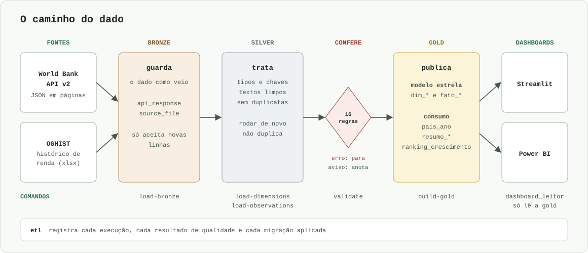

# World-Bank

[](https://github.com/FranciscoAssislsj/World-Bank/actions/workflows/ci.yml)

Pipeline de dados que consome a [World Bank Indicators API v2](https://datahelpdesk.worldbank.org/knowledgebase/articles/889392) e organiza os dados em **arquitetura medalhão** (`bronze` → `silver` → `gold`) no **PostgreSQL**, com dashboards em Streamlit e Power BI.

> Em validação final. O código e a documentação estão prontos, e falta a conferência final do projeto.

**Documentação completa:** [franciscoassislsj.github.io/World-Bank](https://franciscoassislsj.github.io/World-Bank/).

**Rastreabilidade:** cada indicador da camada gold sai de um arquivo em `sql/gold/`, cada decisão sobre o dado tem motivo em [docs/data-decisions.md](docs/data-decisions.md), os erros da IA ficam em [docs/ai-log.md](docs/ai-log.md), e o histórico do git tem um commit por etapa.

**Fonte dos dados:** World Bank, World Development Indicators e histórico de classificação de renda (`OGHIST`), sob licença [CC BY 4.0](https://datacatalog.worldbank.org/public-licenses#cc-by).

## As três camadas



Cada camada tem um papel ([D-087](docs/data-decisions.md)):

- **Bronze** guarda o dado como veio, e só aceita novas linhas.
- **Silver** trata o dado: tipos, chaves e duplicatas.
- **Gold** publica o modelo estrela e as tabelas prontas para os dashboards. As tabelas de consumo leem só a estrela.

Mais detalhes em [Arquitetura](docs/architecture.md).

## Os indicadores

São 15 séries da base WDI, de 2000 a 2024. Todas estão em [`gold.fato_observacao`](sql/gold/09_fato_observacao.sql), com uma coluna em [`gold.pais_ano`](sql/gold/20_pais_ano.sql) e um resumo por renda e região em [`gold.resumo_renda_regiao`](sql/gold/21_resumo_renda_regiao.sql).

| Indicador | Código na API | Coluna em `gold.pais_ano` |
|---|---|---|
| População total | `SP.POP.TOTL` | `populacao` |
| População urbana (% do total) | `SP.URB.TOTL.IN.ZS` | `populacao_urbana_pct` |
| Expectativa de vida ao nascer (anos) | `SP.DYN.LE00.IN` | `expectativa_vida` |
| PIB nominal (US$ correntes) | `NY.GDP.MKTP.CD` | `pib_usd` |
| PIB per capita nominal (US$ correntes) | `NY.GDP.PCAP.CD` | `pib_per_capita_usd` |
| Crescimento real do PIB (% ao ano) | `NY.GDP.MKTP.KD.ZG` | `crescimento_pib_pct` |
| Inflação ao consumidor (% ao ano) | `FP.CPI.TOTL.ZG` | `inflacao_pct` |
| Taxa de desemprego (% da força de trabalho) | `SL.UEM.TOTL.ZS` | `desemprego_pct` |
| Taxa de pobreza, até US$ 3,00 por dia (% da população) | `SI.POV.DDAY` | `pobreza_pct` |
| Índice de Gini | `SI.POV.GINI` | `gini` |
| Alfabetização de adultos (%) | `SE.ADT.LITR.ZS` | `alfabetizacao_pct` |
| Gasto corrente em saúde (% do PIB) | `SH.XPD.CHEX.GD.ZS` | `gasto_saude_pib_pct` |
| Acesso à eletricidade (% da população) | `EG.ELC.ACCS.ZS` | `acesso_eletricidade_pct` |
| Usuários de internet (% da população) | `IT.NET.USER.ZS` | `acesso_internet_pct` |
| CO₂ per capita (t CO₂e por pessoa) | `EN.GHG.CO2.PC.CE.AR5` | `co2_per_capita` |

As contas feitas com eles têm cada uma o seu arquivo:

| Pergunta | Arquivo |
|---|---|
| Como riqueza, saúde, eletricidade e internet se relacionam em cada país e ano? | [`20_pais_ano.sql`](sql/gold/20_pais_ano.sql) |
| Como cada indicador evolui por nível de renda e por região? | [`21_resumo_renda_regiao.sql`](sql/gold/21_resumo_renda_regiao.sql) |
| Em cada ano, quanto a renda muda a expectativa de vida, e onde o Brasil está? | [`22_resumo_anual.sql`](sql/gold/22_resumo_anual.sql) |
| Quais países mais cresceram na última década? | [`23_ranking_crescimento.sql`](sql/gold/23_ranking_crescimento.sql) |
| A soma dos países bate com o número oficial? | [`24_reconciliacao_agregados.sql`](sql/gold/24_reconciliacao_agregados.sql) |

## Como rodar do zero

Pré-requisitos: [pyenv](https://github.com/pyenv-win/pyenv-win) com Python 3.14, [uv](https://docs.astral.sh/uv/) e Docker.

```bash
uv sync                      # cria a .venv e instala as dependências do uv.lock
cp .env.example .env         # depois, ajuste os valores locais
docker compose up -d --wait  # sobe o PostgreSQL 17 em 127.0.0.1:5433
uv run python -m world_bank migrate      # cria os schemas e as tabelas
uv run python -m world_bank load-bronze  # grava na bronze as respostas da API e o histórico de renda
uv run python -m world_bank load-dimensions  # grava os cadastros da silver a partir da bronze
uv run python -m world_bank load-observations  # grava os valores dos indicadores na silver
uv run python -m world_bank validate  # inspeciona a qualidade da silver
uv run python -m world_bank build-gold  # recria as views da gold
```

Ou tudo de uma vez, parando na primeira falha. Uma regra de erro impede a gold de ser recriada ([D-068](docs/data-decisions.md)):

```bash
uv run python -m world_bank run-all  # aceita --start, --end e --full-refresh
```

O banco fica na porta **5433** do computador, e não na 5432, para não conflitar com um PostgreSQL já instalado.

`load-bronze` e `load-observations` aceitam `--start` e `--end` para mudar o período das observações (padrão: 2000–2024). Rodar de novo o `load-bronze` só grava as requisições cujo conteúdo mudou na API ([D-010](docs/data-decisions.md)). O `load-observations` é pulado se a bronze não mudou, e `--full-refresh` força o reprocessamento ([D-045](docs/data-decisions.md)).

O que cada comando lê e grava está em [Pipelines](docs/pipelines.md), e as variáveis do `.env`, em [Configuração](docs/configuration.md).

## O que é uma linha de cada tabela

As tabelas da gold são *materialized views*: no DBeaver, ficam na pasta **Materialized Views** do schema `gold`, e não em **Tables**.

| Tabela | Uma linha é |
|---|---|
| `bronze.api_response` | uma página de resposta da API, com o JSON original em `payload` |
| `bronze.source_file` | uma versão de um arquivo baixado fora da API, sem alteração |
| `silver.regiao` | uma região geográfica ou um agrupamento de países, já tratado |
| `silver.nivel_renda` | um nível de renda ou um agrupamento de níveis, já tratado |
| `silver.tipo_emprestimo` | um tipo de empréstimo do World Bank, já tratado |
| `silver.pais` | um país ou um agregado, já tratado |
| `silver.classificacao_renda_anual` | a classificação oficial de renda de um país em um ano |
| `silver.fonte` | uma base de dados do World Bank, já tratada |
| `silver.topico` | um tema dos indicadores, já tratado |
| `silver.indicador` | uma série de dados, já tratada |
| `silver.indicador_topico` | a ligação entre um indicador e um tema |
| `silver.observacao` | o valor de um indicador para um país ou agregado em um ano, já tratado |
| `silver.nome_portugues` | o nome em português de um código da API ([D-082](docs/data-decisions.md)) |
| [`gold.dim_regiao`](sql/gold/01_dim_regiao.sql) | uma região ou um agrupamento de países |
| [`gold.dim_nivel_renda`](sql/gold/02_dim_nivel_renda.sql) | um nível de renda ou um agrupamento de níveis |
| [`gold.dim_tipo_emprestimo`](sql/gold/03_dim_tipo_emprestimo.sql) | um tipo de empréstimo |
| [`gold.dim_fonte`](sql/gold/04_dim_fonte.sql) | uma base de dados do World Bank |
| [`gold.dim_topico`](sql/gold/05_dim_topico.sql) | um tema dos indicadores |
| [`gold.dim_pais`](sql/gold/06_dim_pais.sql) | um país ou um agregado |
| [`gold.dim_indicador`](sql/gold/07_dim_indicador.sql) | uma série de dados |
| [`gold.ponte_indicador_topico`](sql/gold/08_ponte_indicador_topico.sql) | a ligação entre um indicador e um tema |
| [`gold.fato_observacao`](sql/gold/09_fato_observacao.sql) | o valor de um indicador para um país ou agregado em um ano |
| [`gold.fato_renda_anual`](sql/gold/10_fato_renda_anual.sql) | a classificação oficial de renda de um país em um ano |
| [`gold.valores_atipicos`](sql/gold/11_valores_atipicos.sql) | um valor apontado como estranho, com o motivo e o tratamento |
| [`gold.pais_ano`](sql/gold/20_pais_ano.sql) | um país em um ano, com um indicador por coluna |
| [`gold.resumo_renda_regiao`](sql/gold/21_resumo_renda_regiao.sql) | um indicador em um ano, em um recorte de renda, região ou mundo; filtre `recorte` para não contar em dobro |
| [`gold.resumo_anual`](sql/gold/22_resumo_anual.sql) | um ano, com os números dos cartões dos dashboards |
| [`gold.ranking_crescimento`](sql/gold/23_ranking_crescimento.sql) | um país, com o crescimento na última década e a posição |
| [`gold.reconciliacao_agregados`](sql/gold/24_reconciliacao_agregados.sql) | a soma dos países contra o número oficial, por agregado, indicador e ano |
| `etl.pipeline_run` | uma execução de um comando do pipeline |
| `etl.quality_check` | o resultado de uma regra de qualidade em uma execução |
| `etl.schema_migrations` | uma migração de `sql/migrations/` já aplicada |

## Modelo de dados


`fato_observacao` guarda os valores e liga países e indicadores. Ao somar, filtre `dim_pais.e_agregado`, para não contar países e agregados juntos. Para a renda de um país em um ano, use `fato_renda_anual`.

As colunas de cada tabela, com tipo de valor e descrição, estão no [dicionário de dados](docs/dicionario-dados.md).

## Qualidade dos dados

Cada regra é um arquivo em `sql/quality/`. **Erro** é o que não pode ser verdade, como um percentual acima de 100: a carga é desfeita e nada é publicado. **Aviso** é o que pode ser real e merece atenção: fica registrado em `etl.quality_check`.

Os valores da fonte nunca são alterados, e o dado do World Bank é tratado como fiel ([D-052 e D-070](docs/data-decisions.md)). As 16 regras e os avisos atuais estão em [Qualidade dos dados](docs/quality.md). O principal cuidado ao usar os dados: a média de um grupo pequeno pode ser puxada por um valor estranho, e por isso `gold.resumo_renda_regiao` traz `mediana` ao lado de `media`.

## Testes e qualidade

```bash
uv run ruff format --check .
uv run ruff check .
uv run pytest                # testes unitários: sem rede e sem banco, cobertura >= 70%
uv run --group dashboard pytest -m integration --no-cov # testes contra o PostgreSQL local, com a silver carregada
```

O [CI](.github/workflows/ci.yml) roda essas conferências em uma máquina limpa, incluindo o pipeline completo contra a API real. Pre-commit, CI e convenções estão em [Desenvolvimento](docs/development.md).

## Dashboards

O layout foi desenhado antes, no Figma ([imagens](docs/dashboard/layout/)), e as telas atuais estão em [docs/dashboard/streamlit](docs/dashboard/streamlit/). Os dashboards leem só a gold, com um usuário do banco que não consegue ler mais nada ([D-078 e D-079](docs/data-decisions.md)).

```bash
uv run python -m world_bank migrate   # define a senha do usuário dos dashboards, vinda do .env
uv run --group dashboard streamlit run dashboard/app.py   # abre em http://localhost:8501
```

| Tela | O que mostra |
|---|---|
| Renda e qualidade de vida | Países analisados, expectativa de vida por faixa de renda e PIB per capita × expectativa de vida |
| PIB e crescimento | PIB por país ao longo do tempo, os 10 maiores PIBs e o ranking de crescimento dos últimos 10 anos |

O relatório do Power BI está em [`dashboard/powerbi/`](dashboard/powerbi/), como projeto `.pbip` ([D-086](docs/data-decisions.md)), e exportado em [PDF](docs/dashboard/world_bank_powerbi.pdf). Com o banco ligado, abra `dashboard/powerbi/world_bank.pbip` no Power BI Desktop e clique em **Atualizar**. A credencial e os demais passos estão em [Dashboards](docs/dashboards.md).

## Onde a IA errou

O projeto foi feito com ajuda de uma IA (Claude), e cada erro ficou registrado em [docs/ai-log.md](docs/ai-log.md). Estes mudaram o projeto:

- **Seguiu o plano sem questionar:** pôs o modelo estrela na silver, sem motivo escrito, por 6 fases. O responsável perguntou por que as dimensões não estavam na gold, e a estrela foi movida ([D-087](docs/data-decisions.md)).
- **Decidiu sobre o dado sem medir:** primeiro recomendou manter os valores atípicos na média, depois propôs remover os 29. O responsável pediu a medição e a análise de cada caso, que mostraram que parte dos valores era real ([D-062](docs/data-decisions.md)).
- **Confiou em teste que não testava tudo:** considerou o Streamlit pronto porque os testes passavam, mas o ranking quebrava no navegador. Agora as telas também são conferidas em um navegador.
- **Leu só a contagem de testes:** registrou "42 passed" sem ver que o comando terminava com erro e que 26 testes se pulavam com o banco vazio. Agora o CI não aceita teste pulado ([D-072](docs/data-decisions.md)).
- **Passou um comando sem testar:** o pacote indicado para o MCP do Postgres não funcionava em nenhuma versão disponível. O projeto passou a usar a imagem Docker.
- **Não conferiu o ambiente:** usou a porta 5432, já ocupada por outro PostgreSQL, e o erro de senha parecia ser outro problema. O banco foi para a 5433.
