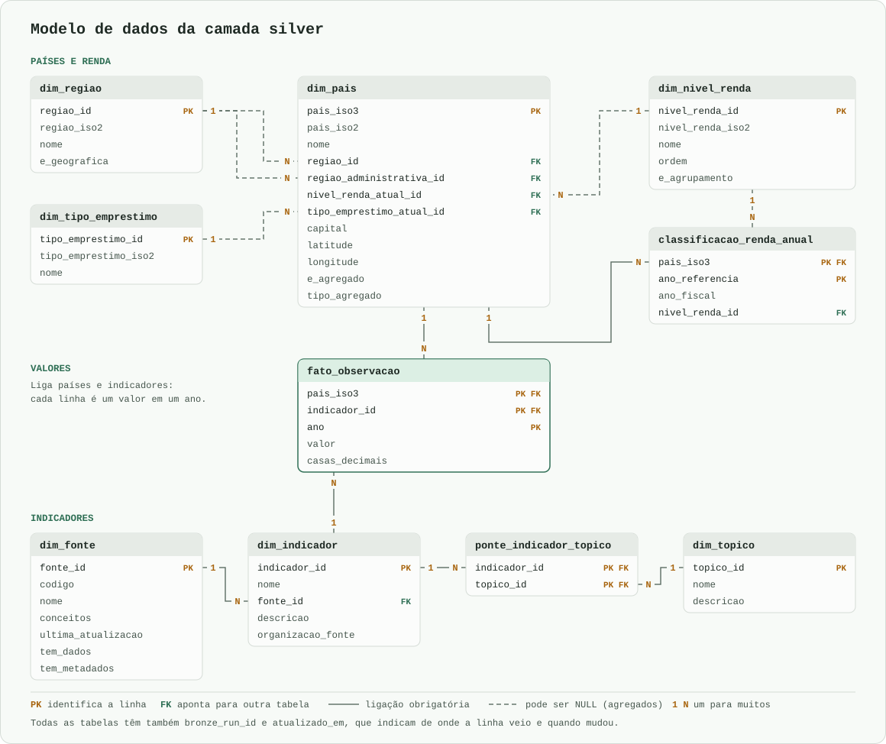

# World-Bank

[](https://github.com/FranciscoAssislsj/World-Bank/actions/workflows/ci.yml)

Pipeline de dados que consome a [World Bank Indicators API v2](https://datahelpdesk.worldbank.org/knowledgebase/articles/889392) e organiza os dados em **arquitetura medalhão** (`bronze` → `silver` → `gold`) no **PostgreSQL**, com dashboards em Streamlit e Power BI.

> Em construção. A documentação completa (tabelas, indicadores, dashboards e a seção "Onde a IA errou") entra na fase final.

**Rastreabilidade:** cada indicador da camada gold sai de um arquivo em `sql/gold/`, cada decisão sobre o dado tem motivo em [docs/data-decisions.md](docs/data-decisions.md), os erros da IA ficam em [docs/ai-log.md](docs/ai-log.md), e o histórico do git tem um commit por etapa.

**Fonte dos dados:** World Bank, World Development Indicators e histórico de classificação de renda (`OGHIST`), sob licença [CC BY 4.0](https://datacatalog.worldbank.org/public-licenses#cc-by).

## Como rodar do zero

Pré-requisitos: [pyenv](https://github.com/pyenv-win/pyenv-win) com Python 3.14, [uv](https://docs.astral.sh/uv/) e Docker.

```bash
uv sync                      # cria a .venv e instala as dependências do uv.lock
cp .env.example .env         # depois, ajuste os valores locais
docker compose up -d --wait  # sobe o PostgreSQL 17 em 127.0.0.1:5433
uv run python -m world_bank migrate      # cria os schemas e as tabelas
uv run python -m world_bank load-bronze  # grava na bronze as respostas da API e o histórico de renda
uv run python -m world_bank load-dimensions  # grava os cadastros da silver a partir da bronze
uv run python -m world_bank load-observations  # grava os valores dos indicadores na silver
uv run python -m world_bank validate  # inspeciona a qualidade da silver
uv run python -m world_bank build-gold  # recria as views da gold
```

Ou tudo de uma vez, parando na primeira falha. Uma regra de erro impede a gold de ser recriada ([D-068](docs/data-decisions.md)):

```bash
uv run python -m world_bank run-all  # aceita --start, --end e --full-refresh
```

O banco fica na porta **5433** do computador, e não na 5432, para não conflitar com um PostgreSQL já instalado.

`load-bronze` e `load-observations` aceitam `--start` e `--end` para mudar o período das observações (padrão: 2000–2024). Rodar de novo o `load-bronze` só grava as requisições cujo conteúdo mudou na API ([D-010](docs/data-decisions.md)). O `load-observations` é pulado se a bronze não mudou, e `--full-refresh` força o reprocessamento ([D-045](docs/data-decisions.md)).

| Tabela | Uma linha é |
|---|---|
| `bronze.api_response` | uma página de resposta da API, com o JSON original em `payload` |
| `bronze.source_file` | uma versão de um arquivo baixado fora da API, sem alteração |
| `silver.dim_regiao` | uma região geográfica ou um agrupamento de países |
| `silver.dim_nivel_renda` | um nível de renda ou um agrupamento de níveis |
| `silver.dim_tipo_emprestimo` | um tipo de empréstimo do World Bank |
| `silver.dim_pais` | um país ou um agregado |
| `silver.classificacao_renda_anual` | a classificação oficial de renda de um país em um ano |
| `silver.dim_fonte` | uma base de dados do World Bank |
| `silver.dim_topico` | um tema dos indicadores |
| `silver.dim_indicador` | uma série de dados |
| `silver.ponte_indicador_topico` | a ligação entre um indicador e um tema |
| `silver.fato_observacao` | o valor de um indicador para um país ou agregado em um ano |
| [`gold.pais_ano`](sql/gold/pais_ano.sql) | um país em um ano, com um indicador por coluna |
| [`gold.resumo_renda_regiao`](sql/gold/resumo_renda_regiao.sql) | um indicador em um ano, em um recorte de renda, região ou mundo; filtre `recorte` para não contar em dobro |
| [`gold.ranking_crescimento`](sql/gold/ranking_crescimento.sql) | um país, com o crescimento na última década e a posição |
| [`gold.reconciliacao_agregados`](sql/gold/reconciliacao_agregados.sql) | a soma dos países contra o número oficial, por agregado, indicador e ano |
| [`gold.valores_atipicos`](sql/gold/valores_atipicos.sql) | um valor apontado como estranho, com o motivo e o tratamento |
| `etl.pipeline_run` | uma execução de um comando do pipeline |
| `etl.quality_check` | o resultado de uma regra de qualidade em uma execução |
| `etl.schema_migrations` | uma migração de `sql/migrations/` já aplicada |

## Modelo de dados



`fato_observacao` guarda os valores e liga países e indicadores. Ao somar, filtre `dim_pais.e_agregado`, para não contar países e agregados juntos. Para a renda de um país em um ano, use `classificacao_renda_anual`.

As colunas de cada tabela, com tipo de valor e descrição, estão no [dicionário de dados](docs/dicionario-dados.md).

## Qualidade dos dados

Cada regra é um arquivo em `sql/quality/`. **Erro** é o que não pode ser verdade, como um percentual acima de 100: a carga é desfeita e nada é publicado. **Aviso** é o que pode ser real e merece atenção: fica registrado em `etl.quality_check`.

Os valores da fonte nunca são alterados, e o dado do World Bank é tratado como fiel ([D-052 e D-070](docs/data-decisions.md)). Ao usar os dados, considere os avisos atuais:

- **Valores improváveis (29):** cada caso foi investigado, e todos ficam nas contas, com o número da fonte e uma marca ([D-062](docs/data-decisions.md)). A média de um grupo pequeno pode ser puxada por um deles: em 2012, o CO₂ per capita de Palau leva a média do seu grupo de 9 países a 24,90, com mediana de 1,32. Por isso, `gold.resumo_renda_regiao` traz `mediana` e `valores_atipicos` ao lado de `media`. A lista está em `gold.valores_atipicos`, e a investigação, em [data-decisions.md](docs/data-decisions.md).
- **Pouca cobertura (76 pares de indicador e ano):** alfabetização, pobreza, Gini e gastos com saúde têm valor em menos da metade dos países em alguns anos, inclusive em 2024.
- **Sem classificação de renda (129 pares de país e ano).**
- **Agregado sem nenhum valor (1):** `Not classified`.

## Testes e qualidade

```bash
uv run ruff format --check .
uv run ruff check .
uv run pytest                # testes unitários: sem rede e sem banco, cobertura >= 70%
uv run pytest -m integration --no-cov # testes contra o PostgreSQL local, com a silver carregada
```

O `--no-cov` existe porque a cobertura mínima vale para os testes unitários. Sem ele, o comando termina com erro mesmo com todos os testes passando.

O [CI](.github/workflows/ci.yml) roda essas conferências em uma máquina limpa a cada envio para `dev` e `main` e em cada pull request para a `main`. Ele sobe o banco, roda o `run-all` contra a API real e não aceita teste de integração pulado ([D-071 a D-074](docs/data-decisions.md)). Se a API do World Bank estiver fora do ar, o CI fica vermelho sem que o código tenha problema: nesse caso, rode de novo.
