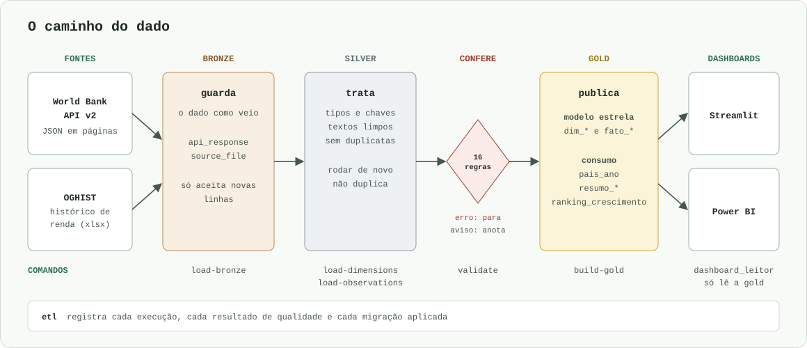

# Arquitetura

O dado passa por três camadas, cada uma com um papel ([D-087](data-decisions.md)). Elas são schemas do mesmo banco PostgreSQL.



## As três camadas

| Camada | Papel | O que tem |
|---|---|---|
| `bronze` | **guarda** o dado como veio | cada página da API, com o JSON original, e cada versão do arquivo de renda |
| `silver` | **trata** o dado | tipos certos, chaves, textos limpos e sem duplicatas, com colunas em português |
| `gold` | **publica** o dado | o modelo estrela e as tabelas prontas para os dashboards |

Um quarto schema, `etl`, não guarda dados de negócio. Ele registra as execuções, os resultados da qualidade e as migrações aplicadas.

### Bronze: nunca muda

A bronze só aceita novas linhas. Um gatilho do banco recusa `UPDATE`, `DELETE` e `TRUNCATE` ([D-009](data-decisions.md)). Assim, se a silver tiver um erro, ela pode ser refeita daqui, sem chamar a API de novo ([D-008](data-decisions.md)).

### Silver: rodar de novo não duplica

A silver grava com *upsert*: a linha que já existe é atualizada, e a nova é inserida. Rodar duas vezes dá o mesmo resultado.

### Gold: sempre recriada a partir de um arquivo

Cada tabela da gold é uma *materialized view*: uma consulta com o resultado salvo, para os dashboards lerem rápido. Ela nasce de um arquivo em [`sql/gold/`](https://github.com/FranciscoAssislsj/World-Bank/tree/main/sql/gold), com a pergunta de negócio, o que é uma linha e as regras no cabeçalho ([D-069](data-decisions.md)).

!!! note "Onde achar a gold no DBeaver"
    Como são *materialized views*, as tabelas da gold, inclusive as `dim_*` e os `fato_*`, ficam na pasta **Materialized Views** do schema `gold`, e não em **Tables**. Já as tabelas da silver têm outros nomes, sem prefixo, como `silver.pais`, e guardam o dado tratado que alimenta a gold. O DBeaver guarda a lista na memória: se faltar alguma tabela, selecione o schema e aperte **F5**.

O número no nome do arquivo define a ordem de criação ([D-088](data-decisions.md)): de 01 a 11, a estrela e os valores atípicos; de 20 em diante, as tabelas de consumo. O `build-gold` troca tudo em uma só transação, então quem consulta nunca vê metade nova e metade antiga ([D-056](data-decisions.md)).

## O modelo estrela


- **Fato** guarda os valores medidos. **Dimensão** descreve quem ou o que foi medido.
- `fato_observacao` tem o valor de um indicador, para um país ou agregado, em um ano.
- `fato_renda_anual` tem a classificação de renda de um país em um ano. Use esta tabela para saber a renda naquele ano, porque `dim_pais` só tem a renda atual ([D-038](data-decisions.md)).
- `ponte_indicador_topico` existe porque um indicador pode estar em mais de um tema.

!!! warning "Cuidado ao somar"
    `dim_pais` guarda países e agregados, como "Mundo", na mesma tabela ([D-023](data-decisions.md)). Ao somar, filtre `dim_pais.e_agregado`, para não contar o mesmo valor duas vezes.

As colunas de cada tabela estão no [dicionário de dados](dicionario-dados.md).

## Organização do código

```text
src/world_bank/
├── extract/      # chama a API: paginação, repetição em erro temporário
├── transform/    # limpa e converte, sem tocar no banco
├── load/         # grava no PostgreSQL
├── validate/     # roda as regras de sql/quality/
├── pipelines/    # junta as partes em cada comando
└── dashboard/    # consultas e formatação do Streamlit
sql/
├── migrations/   # estrutura do banco, em ordem
├── quality/      # uma regra por arquivo
└── gold/         # uma tabela por arquivo
dashboard/        # telas do Streamlit e projeto do Power BI
```

**Motivo da separação:** `transform/` não conhece o banco, então os testes conferem as regras com dados inventados, sem rede e sem PostgreSQL.
