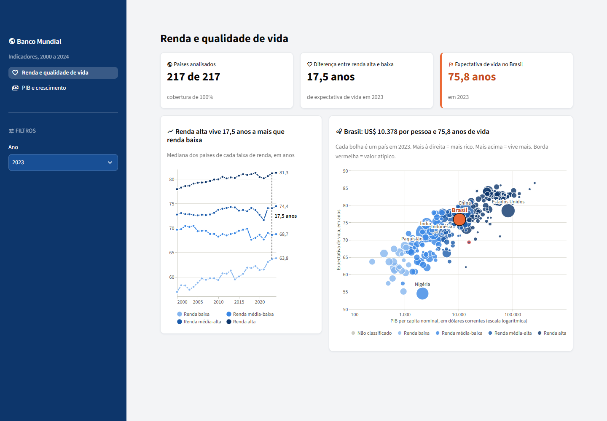
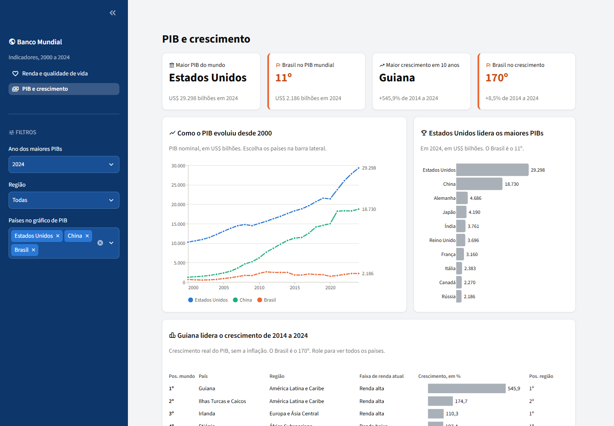
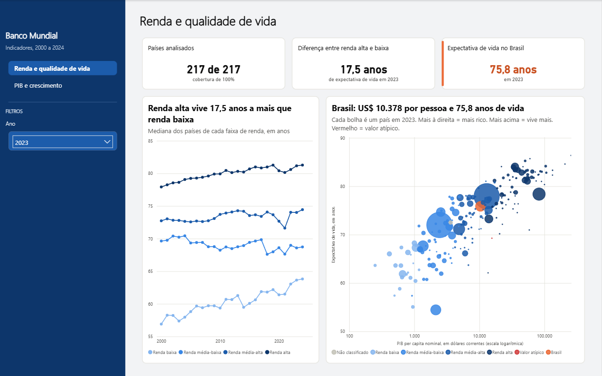
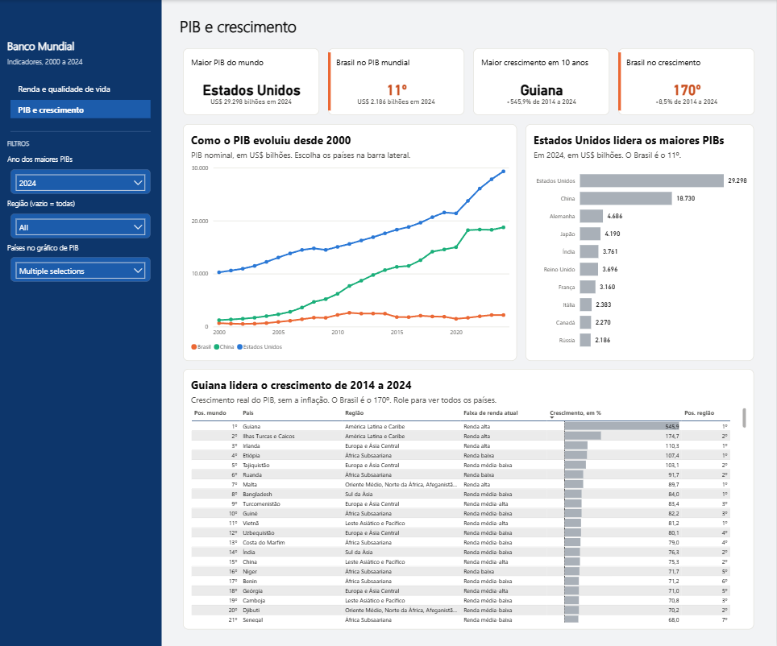

# Dashboards

São dois dashboards com as mesmas 2 telas ([D-083](data-decisions.md)). Eles leem só a gold e não calculam regra de negócio, então o mesmo número aparece nos dois ([D-078](data-decisions.md)). O usuário `dashboard_leitor` não consegue ler mais nada no banco ([D-079](data-decisions.md)).

As telas são contadas a partir do Brasil: laranja é o Brasil, cinza é contexto, e vermelho é queda ou valor atípico ([D-084](data-decisions.md)).

| Tela | O que mostra |
|---|---|
| Renda e qualidade de vida | Países analisados, expectativa de vida por faixa de renda e PIB per capita × expectativa de vida |
| PIB e crescimento | PIB por país ao longo do tempo, os 10 maiores PIBs e o ranking de crescimento dos últimos 10 anos |

## Streamlit

```bash
uv run python -m world_bank migrate   # define a senha do usuário dos dashboards, vinda do .env
uv run --group dashboard streamlit run dashboard/app.py   # abre em http://localhost:8501
```





## Power BI

O relatório está em `dashboard/powerbi/`, como projeto `.pbip`: texto que o git consegue comparar ([D-086](data-decisions.md)). Ele não guarda dados nem senha.

1. Com o banco ligado, abra `dashboard/powerbi/world_bank.pbip` no Power BI Desktop.
2. Clique em **Atualizar** e aprove as consultas ao banco.
3. Na credencial do banco, escolha **Banco de dados**, com o usuário `dashboard_leitor` e a senha de `DASHBOARD_DATABASE_URL`.
4. Se o programa avisar sobre conexão sem criptografia, aceite: o banco só existe na sua máquina.

Para mudar o endereço do banco, altere os parâmetros `ServidorBanco` e `NomeBanco`, em **Transformar dados**.

O [relatório em PDF](dashboard/world_bank_powerbi.pdf) mostra as primeiras linhas do ranking. A lista completa está no relatório.





## O layout

O desenho veio antes do código, no Figma ([D-077](data-decisions.md)), e o fundo das páginas do Power BI também ([D-089](data-decisions.md)).

O primeiro desenho tinha 4 telas e um painel de valores atípicos. Depois, o projeto ficou com 2 telas, escolhidas para facilitar a leitura. As imagens guardam os dois momentos:

| Imagem | O que é |
|---|---|
| [Visão geral](dashboard/layout/1-visao-geral.png) | desenho inicial |
| [PIB × expectativa de vida](dashboard/layout/2-pib-expectativa-vida.png) | desenho inicial |
| [Ranking de crescimento](dashboard/layout/3-ranking-crescimento.png) | desenho inicial |
| [Reconciliação](dashboard/layout/4-reconciliacao.png) | desenho inicial |
| [Painel de valores atípicos](dashboard/layout/5-painel-valores-atipicos.png) | desenho inicial |
| [Fundo: renda e vida](dashboard/layout/fundo_renda_e_vida.png) | fundo atual do Power BI |
| [Fundo: PIB e crescimento](dashboard/layout/fundo_pib_e_crescimento.png) | fundo atual do Power BI |
