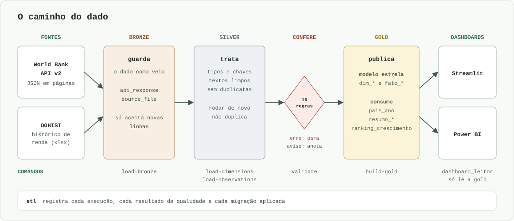

# World Bank Data Pipeline

Este projeto busca dados da [World Bank Indicators API v2](https://datahelpdesk.worldbank.org/knowledgebase/articles/889392), organiza tudo em três camadas no PostgreSQL (`bronze`, `silver` e `gold`) e mostra o resultado em dois dashboards, um em Streamlit e outro em Power BI.

São 15 indicadores, como população, PIB e expectativa de vida, de 2000 a 2024, para países e agregados.

## Como confiar em um número daqui

| Pergunta | Onde está a resposta |
|---|---|
| De onde saiu este indicador? | Cada tabela da gold tem um arquivo em [`sql/gold/`](https://github.com/FranciscoAssislsj/World-Bank/tree/main/sql/gold) |
| Por que o dado foi tratado assim? | Cada decisão tem um motivo em [Decisões sobre o dado](data-decisions.md) |
| O que significa esta coluna? | [Dicionário de dados](dicionario-dados.md) |
| O dado passou por alguma conferência? | [Qualidade dos dados](quality.md) |
| Em que ordem o projeto foi feito? | No [histórico do git](https://github.com/FranciscoAssislsj/World-Bank/commits/main), com um commit por etapa |
| Onde a IA errou? | [Erros e suposições da IA](ai-log.md) |

## Mapa das páginas

- **[Instalação](installation.md):** o que instalar e como rodar do zero.
- **[Configuração](configuration.md):** as variáveis do `.env` e os arquivos de `configs/`.
- **[Arquitetura](architecture.md):** o papel de cada camada e o modelo estrela.
- **[Pipelines](pipelines.md):** o que cada comando lê e grava, e as perguntas que a gold responde.
- **[Fontes de dados](data-sources.md):** como a API funciona e como o projeto a usa.
- **[Qualidade dos dados](quality.md):** as regras e os avisos atuais.
- **[Dashboards](dashboards.md):** as telas e como abrir cada dashboard.
- **[Desenvolvimento](development.md):** lint, testes, CI e convenções.

## Fonte e licença

Os dados são do World Bank: World Development Indicators e histórico de classificação de renda (`OGHIST`), sob licença [CC BY 4.0](https://datacatalog.worldbank.org/public-licenses#cc-by).
